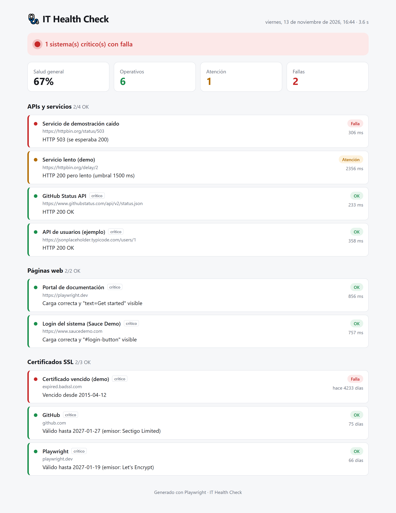

# 🩺 IT Health Check

**Chequeo automatizado de salud de sistemas TI con Playwright.**
Revisa en segundos tus APIs, páginas web y certificados SSL, y genera un reporte HTML con semáforos 🟢🟡🔴 listo para compartir con tu equipo.



## ¿Qué problema resuelve?

- 🔴 Un servicio crítico se cae y TI se entera por los usuarios.
- 🔐 Un certificado SSL vence un viernes en la noche y el sitio queda inaccesible.
- 🐢 Una página "funciona", pero tarda 8 segundos en cargar.
- 🚀 Después de un despliegue, nadie valida rápidamente que todo siga en pie.

Este proyecto convierte esas revisiones manuales en **un solo comando**.

## ¿Qué revisa?

| Tipo | Cómo | Verde 🟢 | Amarillo 🟡 | Rojo 🔴 |
|---|---|---|---|---|
| **APIs y servicios** | Petición HTTP | Código esperado y rápido | Responde, pero lento | Código incorrecto, texto ausente o sin respuesta |
| **Páginas web** | Navegador real (Chromium) | Carga y el elemento clave es visible | Carga lenta | No carga o el elemento no aparece (incluye captura) |
| **Certificados SSL** | Conexión TLS | Más de 30 días de vigencia | Vence en 30 días o menos | Vence en 7 días o menos, vencido o no confiable |

Todos los umbrales se pueden configurar.

## Inicio rápido

```bash
git clone <tu-repo>/it-health-check.git
cd it-health-check
npm install
npx playwright install chromium
npm run health
npm run report
```

> El ejemplo incluye **fallas intencionales** (un servicio que responde 503, uno lento y un certificado vencido) para que veas los tres colores del semáforo.

## Úsalo con tus propios sistemas

Edita [`config/targets.json`](config/targets.json):

```json
{
  "thresholds": { "responseWarnMs": 1500, "responseFailMs": 5000, "sslWarnDays": 30, "sslFailDays": 7 },
  "api": [
    { "name": "API de pedidos", "url": "https://api.miempresa.com/health", "expectStatus": 200, "expectText": "UP", "critical": true }
  ],
  "ui": [
    { "name": "Intranet", "url": "https://intranet.miempresa.com", "expectVisible": "#login", "critical": true }
  ],
  "ssl": [
    { "name": "Portal de clientes", "host": "clientes.miempresa.com" }
  ]
}
```

También puedes mantener varios archivos (uno por ambiente) y elegir cuál usar:

```bash
# Linux / macOS
TARGETS_FILE=config/produccion.json npm run health
```

```powershell
# Windows (PowerShell)
$env:TARGETS_FILE="config/produccion.json"; npm run health
```

## Comandos

| Comando | Qué hace |
|---|---|
| `npm run health` | Ejecuta todos los chequeos |
| `npm run health:api` | Solo APIs y servicios |
| `npm run health:ui` | Solo páginas web |
| `npm run health:ssl` | Solo certificados |
| `npm run report` | Abre el reporte HTML |
| `npm run screenshots` | Genera capturas del reporte (claro y oscuro) en `docs/` |

## Resultados

- `health-report/index.html`: tablero visual autocontenido (un solo archivo, fácil de enviar por correo).
- `health-report/summary.json`: resumen legible por máquinas, útil para integraciones.
- El comando termina con **código de salida 1** si hay alguna falla, así que funciona como compuerta en CI/CD.

## Ejecución programada

Incluye un workflow de GitHub Actions ([`.github/workflows/health-check.yml`](.github/workflows/health-check.yml)) que corre de lunes a viernes y guarda el reporte como artefacto. También puedes ejecutarlo a mano desde la pestaña **Actions**.

## Cómo está construido

```
config/targets.json         ← qué revisar (lo único que necesitas editar)
tests/api.spec.ts           ← chequeos HTTP
tests/ui.spec.ts            ← chequeos con navegador real
tests/ssl.spec.ts           ← vigencia de certificados
reporters/health-reporter.ts← reporter propio de Playwright → HTML + JSON
```

Cada chequeo registra su resultado como adjunto del test, y un **reporter personalizado de Playwright** los reúne en el tablero. Los reintentos automáticos evitan falsas alarmas por un parpadeo de red.

## Ideas para extenderlo

- Notificaciones a Teams, Slack o correo cuando algo falle.
- Historial de ejecuciones con gráficas de tendencia.
- Chequeos de login completos (con usuarios de prueba).
- Revisión de puertos, DNS o espacio en disco.

¿Tienes una idea? ¡Los PR son bienvenidos!

## Licencia

MIT
